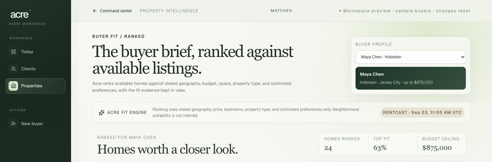
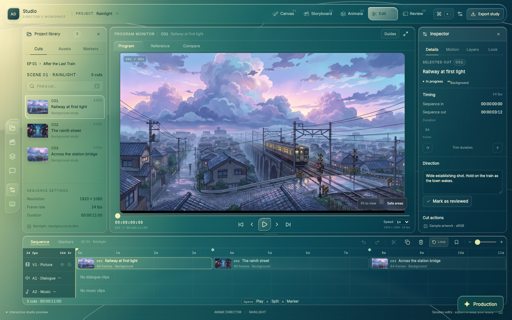
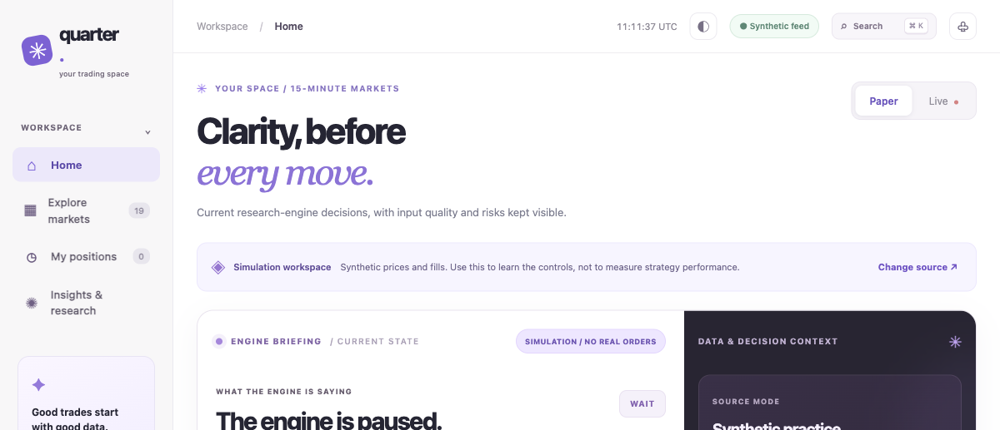

# Randy Kawka | Software Engineering Portfolio

**Full-stack software · Python systems · Applied automation · Creative developer tools**

A curated set of software projects with source code, implementation notes, tests and clear boundaries between working prototypes and unshipped features. I am interested in **junior software engineering, full-stack, frontend and automation roles**.

[GitHub profile](https://github.com/aspher1) · **Role paths:** [Frontend](jobs/frontend-software-engineer.md) · [Full-stack](jobs/full-stack-automation.md) · [Python / reliability](jobs/python-reliability.md) · [All case studies](projects/)

## Where to start

For **web application engineering**, start with [PortalOps AI](projects/portalops.md). For **Python, state management and reliability**, review [rhbot](projects/rhbot.md). For **React/TypeScript, desktop workflows and UI engineering**, explore [Anime Director Studio / Rainlight v8](projects/anime-director-studio.md).

## Recruiter quick paths

Choose a track that matches the role. Each page links specific code, documented limitations, and source-backed résumé bullets instead of broad marketing claims.

- **[Frontend & Product Software Engineer](jobs/frontend-software-engineer.md):** React, Next.js, TypeScript, Electron, browser UI and responsive product workflows.
- **[Full-Stack & Automation Engineer](jobs/full-stack-automation.md):** API routes, Auth.js, validation, human approval, workflow state and SQL/RLS design.
- **[Python & Reliability Engineer](jobs/python-reliability.md):** Simulation, risk controls, data validation, SQLite, automated testing and reproducible research.

[Technical evidence matrix](projects/technical-evidence-matrix.md) · [Reusable, verified résumé statements](resume/engineering-project-bullets.md)

## Selected projects

| Project | Engineering focus | Evidence | Scope |
| --- | --- | --- | --- |
| **[PortalOps AI](projects/portalops.md)** | Typed, human-supervised automation, workflow state, approval policy and tenant-aware data modeling | [Source](https://github.com/aspher1/Portalops) · [Architecture](https://github.com/aspher1/Portalops/blob/main/docs/ARCHITECTURE.md) · [CI](https://github.com/aspher1/Portalops/actions/workflows/ci.yml) | Next.js / TypeScript / Vitest; synthetic-data MVP |
| **[rhbot](projects/rhbot.md)** | Python simulation, error handling, SQLite audit records, modeled fees and operator risk controls | [Source](https://github.com/aspher1/robinhood-bot) · [Architecture](https://github.com/aspher1/robinhood-bot/blob/main/ARCHITECTURE.md) · [CI](https://github.com/aspher1/robinhood-bot/actions/workflows/ci.yml) | Paper-only, no live broker orders |
| **[Anime Director Studio / Rainlight](projects/anime-director-studio.md)** | Frame-accurate editing, animation exposure timelines, drawing tools, desktop app integration and production review | [Public case study and screenshot](projects/anime-director-studio.md) | React / TypeScript / Electron; **private source**, active prototype |
| **[CreditAsk](projects/creditask.md)** | Multi-step form and upload workflows, human-reviewed document drafting and payment-state experiments | [Source](https://github.com/aspher1/Credit-task) · [Tests](https://github.com/aspher1/Credit-task/tree/main/tests) · [CI](https://github.com/aspher1/Credit-task/actions/workflows/ci.yml) | Next.js / Auth.js / Stripe test mode; demo-only |
| **[Jarvis Chart HUD](projects/jarvis.md)** | Chrome extension architecture, host-specific adapters, UI overlays, schema validation and graceful fallback | [Source](https://github.com/aspher1/Jarvis-main) · [Validation](https://github.com/aspher1/Jarvis-main/tree/main/tests) · [CI](https://github.com/aspher1/Jarvis-main/actions/workflows/ci.yml) | JavaScript / MV3 / Shadow DOM; mock data |

## Real application previews

These are captured from local development interfaces. Click a preview to explore its technical case study. Screenshots are evidence of UI work, **not evidence of a deployed product or verified production integrations**.

| Acre: buyer and agent workflow | Rainlight: anime production editor |
| --- | --- |
|  |  |
| Local workspace capture with sample buyers; real property address and price excluded. [Acre case study](projects/acre.md) | Local production-editor capture with imported illustrated media; work in progress. [Rainlight case study](projects/anime-director-studio.md) |

**QuarterPulse: synthetic market research workspace**

*Captured October 2026 with the synthetic feed and paper simulation clearly labeled. See also the [real mobile paper-positions screenshot](assets/previews/quarter-synthetic-paper-positions-mobile.png), which shows fictional practice positions. No live trading, verified return or production performance is implied. [QuarterPulse case study and source-review status](projects/quarterpulse.md).*

## Engineering approach

| Discipline | What to inspect |
| --- | --- |
| **Type-safe product workflows** | Next.js / TypeScript applications, schema validation and explicit workflow states |
| **Reliability and testing** | Vitest, pytest, offline regression tests, GitHub Actions, error handling and operator approval |
| **Data and integrations** | SQLite audit ledgers, PostgreSQL schema/RLS design, public market-data inputs and API stubs |
| **UI and desktop development** | React, Electron, Chrome Manifest V3, adaptive panels, frame timing and browser interaction testing |

The strongest signal is not the number of prototypes. It is how they handle validation, failure, state transitions, human review and clearly documented limitations. Individual project pages link to code and tests so a reviewer can evaluate these decisions directly.

## Additional systems and architecture case studies

These projects have substantial application or research code. Verification varies by project; the case studies document successful checks, checks blocked during the October 27, 2026 audit, and runtime behavior that still needs review. Private source is available for authorized walkthroughs where arranged.

| Project | Engineering strengths | Current verification |
| --- | --- | --- |
| **[Acre: Real-Estate Intelligence](projects/acre.md)** | Next.js, TypeScript, typed listing adapters, property comparison, deterministic cost modeling, Clerk/Drizzle schema | Product-contract check passed; full build and tests pending |
| **[QuarterPulse Research Engine](projects/quarterpulse.md)** | Python market discovery, replay, simulated order matching, fee/risk constraints, audit trails | Private source snapshot on review branch (October 27); fresh tests, live execution and returns remain unverified |
| **[LoopLab Video Studio](projects/looplab.md)** | Cloudflare D1/R2, typed AI-provider orchestration, asynchronous jobs, signed webhooks, usage metering | Offline and paid-provider end-to-end verification pending |
| **[Matchup Lab](projects/matchup-lab.md)** | Exact probability, seeded Monte Carlo, confidence intervals, deck validation, Next.js and Supabase | Test infrastructure exists; latest executions blocked by filesystem issues |
| **[RelayOps: Revenue Recovery OS](projects/relayops.md)** | Next.js/Supabase architecture, PostgreSQL/RLS, consent/idempotency and provider adapters | Private source already exists; local and remote work require reconciliation |

For high-tech job applications, the strongest **publicly inspectable, recently verified source** remains the featured repositories above. These additional case studies are a transparent technical record, not substitutes for completed code review, reproducible builds or production deployments.

## Scope, review and opportunities

Most repositories are **prototypes or research**, not deployed customer systems. Some work uses AI-assisted development tools. A green CI workflow supports the tested checks but does not establish production security, regulatory compliance, user adoption or commercial performance. Each case study distinguishes implementation from plans and known limitations.

I am exploring opportunities in **software engineering, product engineering, frontend development, workflow automation and applied AI tooling**. Public repositories and tests are available for review. For private projects, sanitized code walkthroughs or access to reviewed source branches can be arranged where authorized, using the contact details included with my job application.