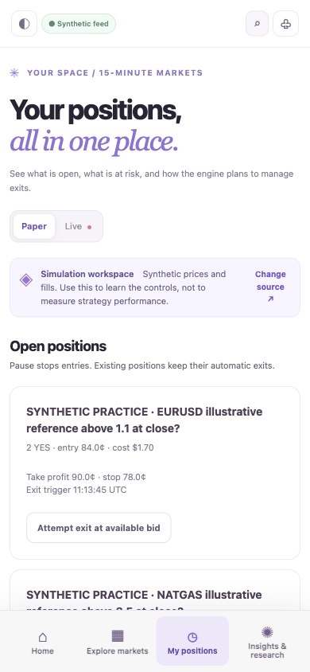

# QuarterPulse: Prediction-Market Research and Paper-Execution Architecture

**Python research platform · order-book and fee simulation · risk controls · reproducible replay · local web dashboard**

QuarterPulse is an experimental system for discovering, evaluating and replaying short-duration prediction markets. Its engineering value is in separating market data, deterministic rules, execution constraints, audit evidence and researcher-facing interfaces.

*Real October 2026 development capture. The interface explicitly says synthetic feed, simulation and paper mode. It does not depict live trades or validated returns.*

### Mobile paper-workspace evidence

*Real local mobile browser capture, October 16, 2026. The positions, example instrument names, prices and exit controls appear under the application's explicit **Synthetic feed**, **Paper** and **Simulation workspace** labels. These fictional practice examples are not live holdings, customer records or evidence of investment performance.*

## Implemented concepts in the code

- **Market discovery:** Kalshi catalog ingestion and selection of markets whose 15-minute cadence can be verified, with conservative restrictions for nonstandard settlement rules.
- **Simulation and replay:** Paper-order lifecycle, position/risk accounting, fills and fees, market-specific decision evidence and offline research modules.
- **Risk and integrity:** Limits, readiness checks, rejection reasons, source/reference provenance, loss investigation and replay-oriented regression tests.
- **Interface:** A web research/dashboard surface with market discovery and opportunity analysis, separate from order infrastructure.

The local application includes **19 illustrative fictional instruments** across crypto, metals, energy and FX for reproducible exploration. They are not proof of 19 live-tradable Kalshi markets.

## Critical trust boundary

Some research branches and local checkout files include authenticated live-order adapter code. It must **not** be assumed to be safe, enabled, audited or ready for real-money trading. Market discovery, replay and simulated profitability are distinct from verified real trading performance. No profitable trading edge or live execution readiness is claimed.

## Verification and private source review

On October 27, 2026, a source snapshot was committed to the private repository `aspher1/quarterpulse-research-engine` on review branch `portfolio/source-audit-20261027`. That branch is **one commit ahead of the tracking-only `main` branch** and changes 79 paths, including Python application code, UI assets, tests and research documentation. Its `PORTFOLIO_SOURCE_AUDIT.md` records exclusions for secrets, databases, local research worktrees, logs and private captures. The snapshot is available only to reviewers granted private repository access; it is **not merged into `main`**.

Earlier development work documented offline regression tests. The October 27 local audit could not complete a fresh test run because of filesystem timeouts; **the imported review-branch source has not been independently retested**. The original checkout still has uncommitted local changes and separate research worktrees that require reconciliation. Neither the source import nor the local UI screenshots verifies real exchange order fills, live-mode safety or financial performance.

**Status:** Substantial private research prototype with a reviewable source snapshot and pending verification. This case study documents source provenance, risk modeling, replay and simulation, not a profitable strategy or production release.

[Back to portfolio](../README.md)